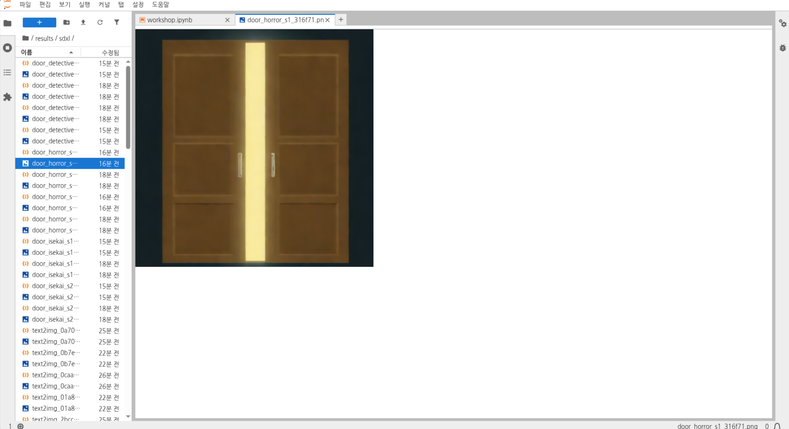
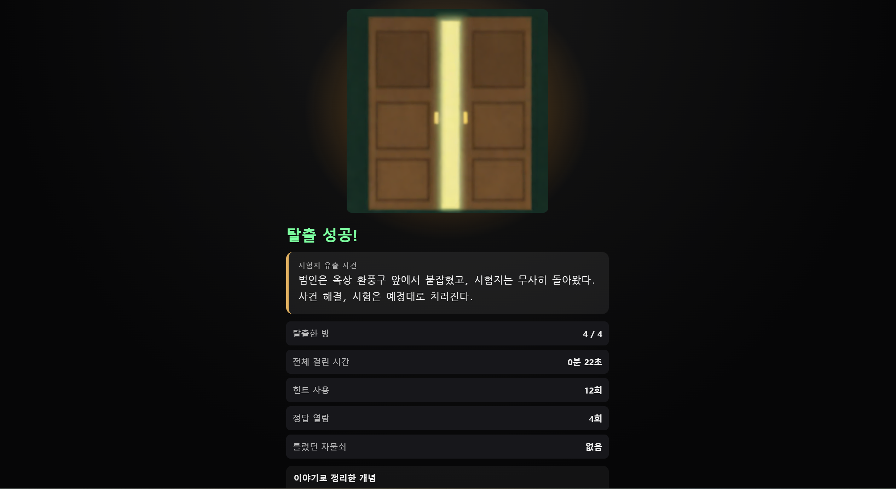

# 틸론 GPU(JupyterLab) 사용 기록

교내 틸론 GPU 서버의 JupyterLab에서 **SDXL-Turbo**로 이미지를 만들어 서비스에 사용했다. 이 문서는 그 과정과 증빙 캡처를 모은 것이다.

## 만든 것
- **탈출 성공 화면의 "문틈으로 빛이 새는 문" 이미지** (`public/images/escape-door.png`)
- 모든 테마(공포·추리·이세계)의 탈출 성공 화면에서 같은 이미지를 쓰고, 이미지 뒤의 은은한 빛 색만 테마마다 다르게 했다.

## 만든 과정
1. **밑그림을 코드로 만들었다.** JupyterLab 노트북에서 코드로 문의 밑그림(두 짝 문이 열려 가운데로 빛이 새는 구도)을 그렸다.
2. **프롬프트를 더했다.** 밑그림에 분위기를 설명하는 프롬프트를 더했다.
3. **img2img로 생성했다.** SDXL-Turbo의 img2img로 밑그림을 바탕으로 이미지를 생성했다. 구도는 밑그림이 잡고, 질감과 빛 표현은 모델이 채우는 방식이다.
4. **결과를 골라 서비스에 넣었다.** 서버 파일 반출이 안 되어 안내에 따라 JupyterLab에 표시된 SDXL 생성 결과(`results/sdxl/` 폴더의 `door_horror` 계열 파일)를 화면 캡쳐해 잘라서 `public/images/escape-door.png`로 사용했다.

## 증빙 캡처

### 1) JupyterLab 파일 트리와 생성 결과

- 왼쪽 파일 트리의 `results / sdxl /` 폴더에 `door_horror_…`, `door_detective_…`, `door_isekai_…` 이름의 이미지가 여러 장 있고, 이미지마다 짝을 이루는 파일(아이콘상 JSON)이 함께 있다. `text2img_…` 이름의 파일도 보인다.
- 오른쪽은 생성된 문 이미지(`door_horror_s1_…png`)를 연 화면이고, 위쪽 탭에는 작업에 쓴 `workshop.ipynb` 노트북이 열려 있다.

### 2) 서비스의 탈출 성공 화면

- 생성한 문 이미지가 탈출 성공 화면 맨 위에 크게 나오고, 그 아래에 결말 문장과 결과 요약(탈출한 방, 걸린 시간, 힌트 사용, 정답 열람, 틀렸던 자물쇠)이 이어진다.
- 이미지 뒤에 은은한 빛이 보이며(이 캡처는 추리 테마의 호박색), 화면 하단에는 출처 문구가 표시된다.

## 서비스에서 쓰이는 방식
| 항목 | 내용 |
|---|---|
| 파일 | `public/images/escape-door.png` (748×756) |
| 표시 위치 | 탈출 성공 화면 맨 위 가운데 (`components/ResultScreen.tsx`), 탈출 실패 화면에는 나오지 않음 |
| 나타나는 방식 | 어둡게 시작해 약 1.8초에 걸쳐 밝아지고 이미지 뒤 빛이 퍼진다. "움직임 줄이기"를 켜면 바로 보인다 (`app/theme-result.css`) |
| 빛 색 | 공포: 따뜻한 흰색 / 추리: 호박색 / 이세계: 하늘색 |
| 출처 표시 | 화면 하단에 "이미지: 틸론 GPU SDXL-Turbo로 생성" |

## 참고와 한계
- 이미지 생성은 서비스를 만들기 전에 GPU 서버에서 미리 해 둔 작업이다. **서비스가 실행되는 동안 GPU를 호출하지는 않는다.**
- 생성에 쓴 노트북 코드, 프롬프트 원문, 생성 설정값은 **이 저장소에 포함하지 않았다.** (노트북은 GPU 서버의 JupyterLab에 있다.)
- 현재 서비스에 쓰는 이미지는 문 이미지 한 장뿐이다. 테마별 배경 이미지(`public/backgrounds/`)도 같은 방식으로 만들 수 있게 자리를 만들어 두었지만 아직 파일은 없다.
